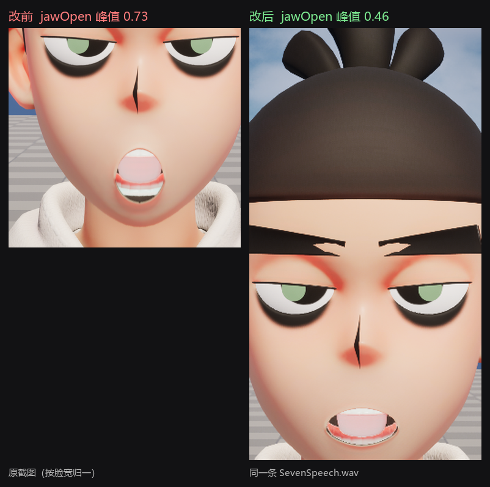
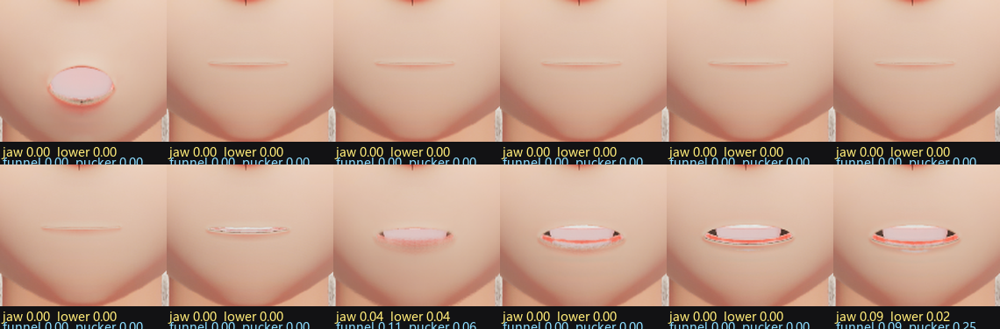

# Seven 口型同步（UE 5.8）

给 `Content/_MyTest/Mouth/Seven`（52 个 ARKit morph target）接上
Runtime MetaHuman Lip Sync 的**真实模型**（`URealisticMetaHumanLipSyncGenerator`），
把 MetaHuman 的 81 个控制量映射成 ARKit blendshape 并每帧写进 mesh。

## 状态

| 项 | 值 |
|---|---|
| 引擎 | UE 5.8.3（`E:\Unreal\UE_5.8`） |
| 插件 | `Plugins/RuntimeMetaHumanLipSync_UE58`（v1.18+5.8，预编译二进制，依赖 `NNERuntimeORT`） |
| 测试关卡 | `/Game/_MyTest/Mouth/L_SevenLipSync`（已设为 EditorStartupMap / GameDefaultMap） |
| 测试 Actor | `ASevenLipSyncActor`（C++，已放在关卡里，名为 `SevenLipSyncCamera`） |
| 音频 | `TestAudio/SevenSpeech.wav`（16 kHz / 单声道 / 16 bit，**阿七原声**，循环播放） |
| 日志 | `SevenLipSync: generator created / playing / jawOpen=... | audio=on queuedKB=...`（Output Log 过滤 `SevenLipSync`） |

## 语音素材（阿七原声）

素材来自 `D:\AI\work\bili-audio\【刺客伍六七】伍六七语音包 320k.mp3`（时长 4:19），
用 whisper(faster-whisper small) 转出了逐句时间轴：`Tools/aqi_transcript.json`。

当前默认播放的是 **`0:106.6 – 0:113.2`**：

> 「我是刺客伍六七，刺客排行榜第 17369 位」

`TestAudio/` 里另有 3 条备选（改 Actor 的 `WavFile` 即可切换）：

| 文件 | 原片时间码 | 台词 |
|---|---|---|
| `aqi_alt_memory.wav` | 3:46.1 – 3:52.6 | 为什么我没有过去的记忆，我以前到底是一个怎么样的人 |
| `aqi_alt_assassin.wav` | 3:04.0 – 3:07.4 | 就算是刺客，也会有想保护的人 |
| `aqi_alt_shadow.wav` | 0:48.3 – 0:51.6 | 我是玄武国的暗影刺客 |
| `SevenSpeech_tts_backup.wav` | — | 之前的中文 TTS 测试音（备份） |

想换别的句子：在 `Tools/export_aqi_lines.py` 的 `CLIPS` 里加一条
`(起始秒, 结束秒)`，重跑脚本就会输出 16 kHz 单声道 wav 到 `TestAudio/`。
时间码从 `Tools/aqi_transcript.json` 里挑。

> 版权提醒：这是《刺客伍六七》的角色原声，做内部测试/风格验证没问题，
> 对外发布或商用前请替换成原创配音。

## 代码

| 文件 | 作用 |
|---|---|
| `Source/MyProject_5_8/LipSync/SevenLipSyncComponent.*` | 核心：建生成器、流式喂 PCM、控制量→ARKit 映射、`SetMorphTarget` |
| `Source/MyProject_5_8/LipSync/SevenLipSyncActor.*` | 测试 rig：`ACameraActor` 子类，相机 + 点光 + Seven mesh + 上面的组件 |

`MyProject_5_8.Build.cs` 增加了 `RuntimeMetaHumanLipSync` 依赖。

### 关键参数（都在 Actor / 组件 Details 里）

| 参数 | 默认 | 说明 |
|---|---|---|
| `WavFile` | `TestAudio/SevenSpeech.wav` | 相对项目根目录；也支持绝对路径 |
| `bAutoStart` | true | BeginPlay 自动播放 |
| `bLoopAudio` | true | 播完循环（demo 用） |
| `Gain` | 1.0 | 全局幅度，**所有**通道一起缩放（含 smile/frown/close），优先用它微调整体表情 |
| `LipSyncJawOpenScale` | 1.0 | **只**缩放 `jawOpen`。嘴张太大 → 调到 0.6~0.7；想更夸张 → 1.2~1.5 |
| `LipSyncJawOpenMax` | 0.60 | `jawOpen` 硬上限（0~1）。元音爆发时真实模型能给到 0.75，这里直接封顶 |
| `LipSyncRoundingScale` | 1.0 | 缩放 `mouthFunnel` / `mouthPucker`（叠加在下巴张开上的那个「圆 O」） |
| `LipSyncJawOpenFloor` | 0.10 | `jawOpen` 死区：低于它算闭嘴，见下一节 |
| `LipSyncLipFollowJaw` | 1.0 | 唇形是否跟着下巴一起收，见下一节 |
| `LipSyncOpenSpeed` / `LipSyncCloseSpeed` | 30 / 40 | 张嘴 / 闭嘴的插值速度 |
| `LipSyncLookaheadMs` | 100 | 模型相对声卡时钟的前瞻补偿；嘴比声音**早**就调小，**晚**就调大 |
| `LipSyncGain` | 1.0 | 整体幅度（映射表里 `jawOpen` 已单独 ×1.2） |
| `LipSyncGateLowRms` | 0.015 | 静音门下限：RMS 低于它就闭嘴（语音 RMS 约 0.1，底噪约 0.007） |
| `LipSyncGateHighRms` | 0.035 | 静音门上限：高于它全量驱动，中间线性过渡 |
| `LoopGapSeconds` | 1.0 | 每轮之间的静音间隔 |
| `bMouthOnly` | true | 只驱动嘴（jaw/mouth/tongue/cheek），不碰眉眼 |
| `MeshLocation / MeshRotation` | (105,0,-158) / yaw 90 | 相对相机的取景（头在相机正前方约 1 m） |
| `CameraFOV` | 35 | |
| `KeyLightIntensity` | 250 cd | |

### 换音频

1. 把 wav 放到 `TestAudio/` 下（任意采样率/位深都行，代码会解码并按 16 kHz 重采样；
   支持 PCM 8/16/24/32bit 和 float32，单/双声道）。
2. 选中关卡里的 `SevenLipSyncCamera` → Details → `Seven / Audio / Wav File` 改成新路径。
3. PIE 即可。

运行时也可以从蓝图调 `StartPlayback(Path)` / `StopPlayback()`。

## 映射表在哪

`SevenLipSyncComponent.cpp` 里的 `GMorphMappings`：

```cpp
{ TEXT("CTRL_C_jaw.ty"),             TEXT("jawOpen"),        1.20f },
{ TEXT("CTRL_L_mouth_cornerPull.ty"),TEXT("mouthSmileLeft"), 1.00f },
...
```

一条记录 = 一个控制量（`GetControlValues()` 的 key）→ 一个 ARKit morph + 系数；
同一个 morph 可以有多条（累加后 clamp 0..1）。要加通道就直接加行、重编译。

> 系数是 2026-11-02 按实测日志重新定过的：真实模型在台词里的原始输出大约是
> `jaw 0.07~0.33`、`funnel 0.3~0.5`。原来 `jawOpen` 乘 2.2，峰值顶到 0.73，
> 看起来就是「下巴掉了」；现在乘 1.2（峰值约 0.40）再叠 `JawOpenMax = 0.6` 兜底，
> `lowerDown` 从 1.0 降到 0.6，`funnel` 两条从 0.5+0.5 降到 0.35+0.35（原来两个
> 控制量一加就饱和成 1.0，张开的嘴变成圆洞）。

当前覆盖：jaw（open/forward/left）、上下唇、嘴角（smile/frown/stretch/dimple/sharpCornerPull）、
funnel、pucker、lipsTogether→close/press、nasolabial→noseSneer、tongueOut；
`bMouthOnly=false` 时额外驱动 brow / eyeBlink / eyeSquint / cheekSquint。

## 口型开合（「张太大」和「一直张着」）



### 为什么它会一直张着

拿真实日志量过（`LogInterval` 改成 0.033 就能拿到 30 Hz 的曲线），模型原始输出：

| 通道 | 台词中的范围 | 中位数 |
|---|---|---|
| `jawOpen`（×1.2 后） | 0.00 ~ 0.46 | 0.14 |
| `mouthFunnel` | 0 ~ 0.35 | 0.06 |
| `mouthPucker` | 0 ~ 0.70 | 0.06 |
| `mouthLowerDown` | 0 ~ 0.20 | 0.03 |

模型**在说话时几乎不会把下巴收回 0**，而这张脸的 morph 又特别敏感：`jawOpen` 只有 0.13
（模型的中位数）时嘴已经能看见一条明显的缝，`funnel`/`pucker`/`lowerDown` 随便哪个非零
都会把嘴唇顶开。所以观感就是"一直张着、只是偶尔开大一点"。

### 现在怎么做的

三处改动，都在 [SevenLipSyncComponent.cpp](../Source/MyProject_5_8/LipSync/SevenLipSyncComponent.cpp)
的 `UpdateMorphTargets()` 里，顺序是：映射累加 → 封顶 → 死区 → 唇形跟随下巴 → 静音门 → 插值。

1. **下巴死区 `JawOpenFloor`（默认 0.10）**：低于它的 `jawOpen` 直接当 0，剩下的区间重新拉伸到 0~1。
2. **唇形跟随下巴 `LipFollowJaw`（默认 1）**：`jawOpen` 关到 0 时把 `mouthFunnel` /
   `mouthPucker` / `mouthLowerDown` 一起乘到 0（下巴开到 0.12 就完全恢复）。这条是关键——
   只压下巴的话，残留的 funnel/pucker 仍然会在嘴唇中间开个洞。
3. **开合速度分离**：`OpenSpeed` 30 / `CloseSpeed` 40，闭嘴比张嘴快一点，音节之间不会拖泥带水。

实测（同一条 `SevenSpeech.wav`，6.8 s 有效语音）：

| | 改前 | 改后 |
|---|---|---|
| `jawOpen` 中位数 | 0.137 | 0.055 |
| 明显闭合（<0.04）占比 | 0% | 45% |
| 闭合次数 | 0 | ~1.6 次/秒，每次约 300 ms |
| 峰值 | 0.46 | 0.41 |



（上排：闭嘴的帧，`jawOpen` 归零后嘴唇是一条实线；下排：张开的帧。每张图下面的数字是该帧
30 Hz 日志里对应的 morph 值。）

## 嘴角拉扯 / 白痕

现象：嘴唇闭着的时候，嘴角还会被往两边拽，唇线被拉出一条白痕，一动起来更明显。

实测（30 Hz 日志，只统计 `jawOpen < 0.02` 的帧，即"嘴闭着"的时候）：

| 通道 | 中位数 | p90 | 最大 |
|---|---|---|---|
| `mouthStretch` | 0.054 | 0.159 | **0.239** |
| `mouthDimple` | 0.047 | 0.122 | 0.169 |
| `mouthSmile` | 0.030 | 0.078 | 0.113 |
| `mouthPress` | 0.016 | 0.030 | 0.066 |

原因很清楚：**嘴闭着，但嘴角拉升类 morph 一直有值**。嘴唇已经闭合，`stretch`/`dimple`/`smile`
再把嘴角往两边拽，唇面没有余量可走，就在嘴角折出一道褶/白痕。

改了三处：

1. **嘴角组跟随下巴**：`mouthSmile` / `mouthStretch` / `mouthDimple` / `mouthFrown` 在下巴闭合时
   只保留 30%（`CornerFloor`），下巴开到 0.12 恢复全量。和 `LipFollowJaw` 同一个开关。
2. **映射系数下调**：`mouthStretch` 1.0 → 0.5、`mouthDimple` 1.0 → 0.5、
   `sharpCornerPull → mouthSmile` 0.35 → 0.15（原来和 `cornerPull` 叠起来会把 `mouthSmile` 顶到饱和）。
3. **逃生口 `MorphScaleOverrides`**：组件上一个 `TMap<FName,float>`，可以按 morph 名字单独乘系数，
   PIE 里改即时生效。怀疑哪个 morph 弄脏了脸，把它填成 0 再看——比改代码重编快得多。

```text
MorphScaleOverrides
  (mouthStretchLeft, 0.0)
  (mouthDimpleLeft, 0.0)
```

> 这类 morph 拉扯本质上是这套 ARKit blend shape 在这张脸（`/Game/_MyTest/111/Seven`）上的
> 权重问题：morph 本身没问题，是嘴角附近的蒙皮没有足够的过渡。所以真正的修法是"别让这些
> morph 在闭嘴时还在动"（上面第 1 条），而不是把表情全部压平。

### 参数

全部在 `SevenLipSyncCamera` 的 Details 里，**PIE 运行中拖动即时生效**：

| 参数 | 默认 | 作用 |
|---|---|---|
| `LipSyncGain` | 1.0 | 全局幅度，所有通道等比缩放（微笑/闭嘴也会一起变） |
| `LipSyncJawOpenScale` | 1.0 | **只**缩放 `jawOpen`。嫌嘴大 → 0.6~0.7；嫌张不开 → 1.3~1.5 |
| `LipSyncJawOpenMax` | 0.60 | `jawOpen` 硬上限 |
| `LipSyncJawOpenFloor` | 0.10 | 死区。**嘴还是常常半张着就把它加大**（0.12~0.15）；矫枉过正、嘴老闭着就降到 0.05~0.07 |
| `LipSyncLipFollowJaw` | 1.0 | 唇形跟随下巴。设 0 就退回"下巴归零但唇形还在"的原始行为 |
| `LipSyncRoundingScale` | 1.0 | 圆唇（funnel/pucker）整体缩放 |
| `LipSyncOpenSpeed` | 30 | 张嘴速度 |
| `LipSyncCloseSpeed` | 40 | 闭嘴速度，别低于 `OpenSpeed`，否则音节会糊成一片 |
| `LipSyncLogInterval` | 0.5 | 日志间隔，调成 0.03 可以打出 30 Hz 的曲线来量 |
| `MorphScaleOverrides` | 空 | 组件上的 map，按 morph 名单独乘系数，见上一节 |

调的顺序：先看 `LipSyncJawOpenFloor`（决定"闭不闭得严"），再看 `LipSyncCloseSpeed`
（决定"闭得干不干脆"），最后用 `LipSyncJawOpenScale` 定整体幅度。

## 身体动画（每轮重播一起重来）

`Body Animation` 里挂一个 `UAnimSequence`，**每次播放开始（首播 + 每一轮循环）都会从第 0 帧
重新播一遍**，这样音频和姿态永远从同一帧起步，循环几轮也不会越跑越偏。

| 参数 | 默认 | 说明 |
|---|---|---|
| `Body Animation` | `5秒台词测试_不带口型_Anim` | 要一起播的动画，可换任意 `AnimSequence` |
| `Body Animation Rate` | 1.0 | 播放速率，1 = 原速 |
| `Restart Animation On Playback` | ✅ | 关掉就只触发一次，之后让动画自己跑（不再对齐每一轮） |

实现位置：`USevenLipSyncComponent::StartAudio()`。首播和"无间隔循环"两条路径最后都收敛到
这个函数，所以放在这里一次就够，不会漏。日志：

```
SevenLipSync: body animation restarted '5秒台词测试_不带口型_Anim' (rate 1.00)
```

两个注意点：

1. **动画里不能有口型曲线**（morph target curve）。有的话它会和组件每帧写的 morph 抢同名通道，
   表现为嘴部抽搐或干脆不动 —— 这也是这条素材叫"不带口型"的原因。
2. 动画是 `PlayAnimation()` 直接打在 `TargetMesh` 上的单节点动画（不需要 AnimBP）。如果哪天给这个
   mesh 挂了 AnimBP，动画仍然会播（会盖掉 AnimBP 的输出），要么关掉 `Restart Animation On Playback`，
   要么改成从 AnimBP 里用变量驱动。

## 声音

口型模型只吃 PCM、不出声，所以组件里另外挂了一个 `USoundWaveProcedural` +
2D `UAudioComponent`（`bIsUISound = true`，不吃距离衰减）：`StartAudio()` 把整段
16 kHz 单声道 PCM 一次性 `QueueAudio` 再 `Play()`，循环时 `Stop → ResetAudio → 重新排队`。

验证办法（Output Log 过滤 `SevenLipSync`）：

```
SevenLipSync: audio queued 6.65s, playing=true
SevenLipSync: jawOpen=... | audio=on queuedKB=-100   ← 这个数每 0.5s 掉 16KB，就是 32KB/s 的播放速率
```

如果还是没声音，按顺序查：

1. PIE 工具栏那个喇叭图标（`Mute Audio`）——它会被记住，之前点过就一直静音；
2. Windows 音量合成器里 `UnrealEditor.exe` 的音量/输出设备；
3. 控制台 `au.MuteAudio` 应为 0（默认就是 0）。

## 已知问题 / 待办

1. **材质**：2026-10-30 修完版本迁移（见 [SevGame_AssetMigration.md](SevGame_AssetMigration.md)）后，
   `SevGame/.../Seven` 的贴图和 11 个 MI 都能正常加载了，之前的「纯色」是因为整批资产因
   引擎版本不匹配而根本没加载。仍有两个槽是默认材质：`Seven_Face_ncl_1`、`09_-_Default`
   （源项目里就没挂，`09 - Default` 是 3ds Max 默认材质名）。
2. **没有身体动画**：mesh 直接播 Ref Pose（A-pose）。要站姿/呼吸/待机，需要给 Seven 建
   AnimBP（Target Skeleton = `Seven_Skeleton`），再把 mesh 的 Anim Class 指过去；
   口型是直接写 morph，**不会**被 AnimBP 覆盖。
   注：`Seven_Hair_AnimBlueprint` 只是头发的 Post Process AnimBP（KawaiiPhysics），不算身体动画。
3. **没有麦克风/实时 TTS**：现在只有「wav 文件 → 口型」。要麦克风就装
   `RuntimeAudioImporter`（D 盘有 5.8 版），把 PCM 回调接到
   `StartPlayback` 同样的 `ProcessAudioData` 路径；要 TTS 就装 `RuntimeTextToSpeech` 5.8。
4. **眨眼/视线没做**：`bMouthOnly=true` 时眼睛是静止的；真实模型本身有 eyeBlink 控制量，
   想要的话把 `bMouthOnly` 关掉即可。
5. **LOD**：morph 只在有 morph 的 LOD 上生效，远处切 LOD 后嘴会不动，属正常。

## 命令备忘

```powershell
# 编译
& 'E:\Unreal\UE_5.8\Engine\Build\BatchFiles\Build.bat' MyProject_5_8Editor Win64 Development `
  -Project="E:\Unreal\Projects\MyProject_5_8\MyProject_5_8.uproject" -WaitMutex

# 启动
& 'E:\Unreal\UE_5.8\Engine\Binaries\Win64\UnrealEditor.exe' `
  "E:\Unreal\Projects\MyProject_5_8\MyProject_5_8.uproject"

# MCP（编辑器开着时）
.\Scripts\ue-mcp.ps1 -Toolsets
.\Scripts\ue-mcp.ps1 -Toolset EditorToolset.EditorAppToolset -Tool StartPIE `
  -Arguments '{"options":{"bSimulate":false,"playMode":"PlayMode_InViewPort","warmupSeconds":4}}'
```

> 编译前必须关掉编辑器（模块 DLL 被占用）。改完 C++ 后重启编辑器才会加载新代码。
